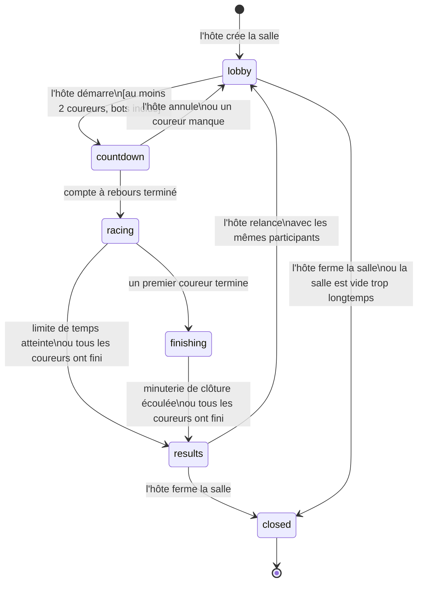
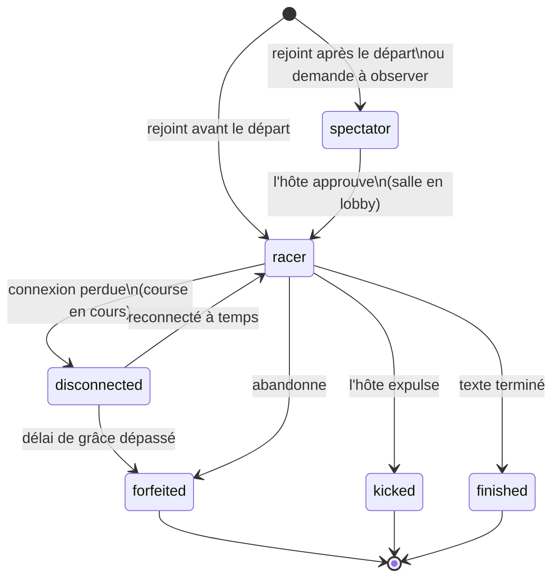

# Machine à états d'une salle et d'une course

Une salle passe par un nombre fixe d'états. Le serveur temps réel est la seule autorité : un client ne change jamais l'état, il envoie une demande que le serveur accepte ou refuse selon l'état courant.

## États d'une salle

| État | Ce qui se passe | Qui peut agir |
|---|---|---|
| `lobby` | Les joueurs arrivent, l'hôte règle les paramètres (visibles de tous, exigence 2.7), peut expulser, approuver des spectateurs, ajouter des bots. | Hôte, joueurs (rejoindre, quitter) |
| `countdown` | Le compte à rebours s'affiche. Le texte est déjà généré mais caché. | Personne ne tape. L'hôte peut annuler. |
| `racing` | Les coureurs tapent. Les positions sont diffusées en temps réel. Les boosts s'appliquent. | Coureurs (frappe, abandon), hôte (expulsion) |
| `finishing` | Un premier coureur a terminé; la minuterie de clôture court pour les autres (exigence 6.2). | Mêmes actions que `racing` |
| `results` | Podium, statistiques et carte de chaleur. Les résultats sont enregistrés dans `race_result`. | Hôte (relancer ou fermer) |
| `closed` | La salle n'accepte plus personne. | Aucune |

### Priorité des conditions de fin

Le cahier des charges signale trois conditions de fin sans ordre (zone floue 2). On applique la règle suivante, la première condition vraie l'emporte :

1. **Tous les coureurs ont terminé, abandonné ou été expulsés** : fin immédiate.
2. **La limite de temps de l'hôte est atteinte** : fin immédiate, même si la minuterie de clôture court encore. Les coureurs non terminés sont classés `timed_out` selon leur progression.
3. **La minuterie de clôture est écoulée** : même traitement que la limite de temps.

La minuterie de clôture ne démarre que si la course n'est pas déjà terminée par la condition 1.

## États d'un joueur dans une salle

- Un joueur déconnecté **reste dans la course** tant qu'elle n'est pas terminée et peut reprendre sa place (exigence 2.10). Le délai de grâce proposé est de 30 secondes, à ajuster.
- Un joueur qui abandonne est considéré comme perdant (exigence 2.11).
- Un joueur qui arrive après le départ devient spectateur pour cette course seulement (exigence 2.13).

## Départ de l'hôte

Si l'hôte se déconnecte brièvement, il reprend son rôle comme n'importe quel joueur. S'il abandonne ou quitte, le rôle passe au participant le plus ancien, ou à celui que l'hôte a désigné avant de partir (réponse du client).

**État actuel de l'implémentation** : l'hôte peut nommer un autre joueur hôte à tout moment (bouton « Nommer hôte »). S'il quitte sans l'avoir fait, le rôle passe au plus ancien joueur *ayant un compte*. Un invité ne peut pas être hôte, car la salle référence un utilisateur en base. S'il ne reste que des invités, la salle se ferme.

## Spectateurs, expulsion et reconnexion

- **Hôte spectateur (2.3)** : l'hôte passe lui-même en spectateur dans le lobby, sans approbation.
- **Demande pour regarder (2.4)** : un joueur demande à regarder; l'hôte accepte ou refuse. Revenir comme coureur ne demande pas d'approbation. Le choix reste valable pour les courses suivantes.
- **Expulsion (2.12)** : l'hôte peut expulser un joueur dans le lobby ou pendant la course. Pendant la course, le joueur est classé `kicked`. Il est retiré de la salle et ne peut plus la rejoindre.
- **Reconnexion (2.10)** : un coureur déconnecté garde sa place tant qu'il est encore en course. Le délai de grâce de 30 secondes est relancé tant que la course n'est pas finie; il ne s'applique vraiment qu'une fois la course terminée ou dans le lobby.

## Visibilité d'une salle

| Visibilité | Comment on entre |
|---|---|
| `public` | Par code, ou par le bouton « Lancer une course » de l'accueil, qui choisit la salle publique en lobby la plus remplie. S'il n'y en a pas, un joueur connecté crée une salle publique et en devient l'hôte; un invité est envoyé dans une course publique en cours (comme spectateur), sinon on lui indique qu'il n'y en a pas. |
| `semi_public` | Par code ou par lien (valeur par défaut d'une salle créée par « Créer une salle »). |
| `private` | Seulement avec un lien d'invitation à usage unique, valable 24 heures. Un membre déjà présent peut se reconnecter sans nouveau lien. |

L'hôte peut changer la visibilité à tout moment; tous les joueurs la voient.

## Messages entre client et serveur (aperçu)

| Direction | Message | Valide dans l'état |
|---|---|---|
| client vers serveur | `room:join` (code) | `lobby`, `racing`, `finishing` (devient spectateur) |
| client vers serveur | `room:quickplay` | toujours (accueil) |
| client vers serveur | `room:visibility` | tous les états, hôte seulement |
| client vers serveur | `room:invite` | tous les états, hôte seulement |
| client vers serveur | `member:watch` | `lobby` |
| client vers serveur | `member:approve` | hôte seulement |
| client vers serveur | `member:kick` | hôte seulement |
| client vers serveur | `member:promote` | hôte seulement, cible avec un compte |
| client vers serveur | `room:configure` (paramètres partiels, validés et fusionnés par le serveur) | `lobby` et `results`, hôte seulement |
| client vers serveur | `race:start` | `lobby`, hôte seulement |
| client vers serveur | `race:progress` (position dans le texte) | `racing`, `finishing` |
| client vers serveur | `race:forfeit` | `racing`, `finishing` |
| serveur vers clients | `room:state` (instantané complet) | à chaque changement d'état |
| serveur vers clients | `race:positions` | environ 10 fois par seconde pendant la course |
| serveur vers un client | `room:kicked` | quand l'hôte expulse ce joueur |

Les messages reçus dans un état qui ne les accepte pas sont ignorés et journalisés.

## Bots

- Le minimum de 2 coureurs inclut les bots : un joueur seul peut lancer une course contre un bot si l'hôte a laissé les bots activés. Il faut toujours au moins un humain parmi les coureurs.
- Les bots ne retiennent pas la course : dès qu'aucun humain n'est encore en course (tous ont fini ou abandonné), la course passe à `results`.

## Points à valider

- Durée de la minuterie de clôture (30 secondes proposées) et du délai de grâce de reconnexion (30 secondes proposées).
