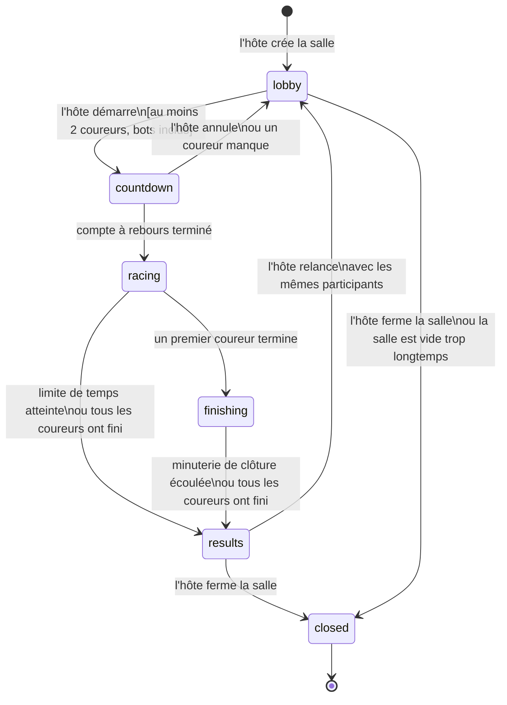
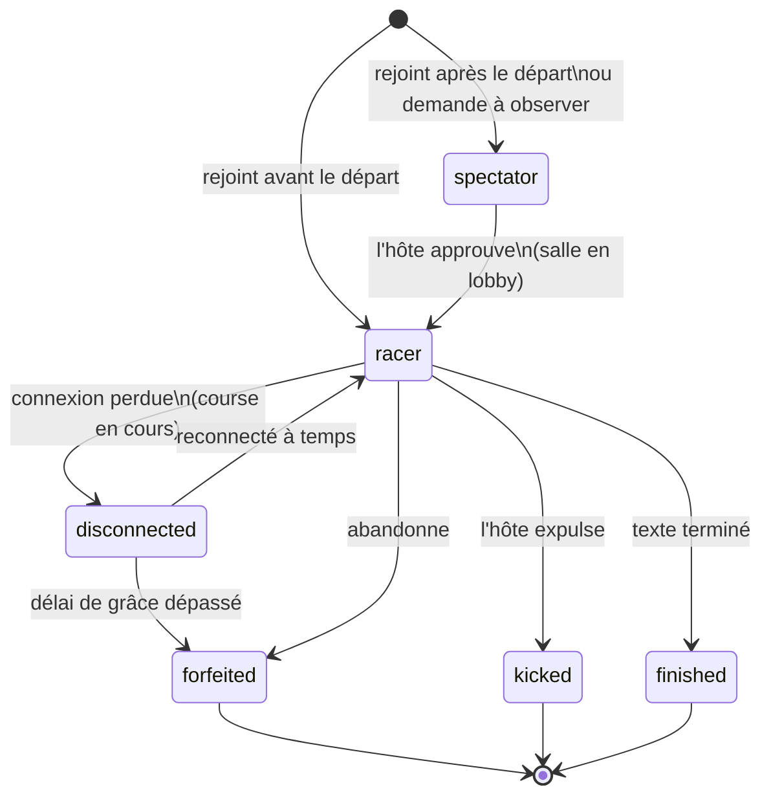

# Machine à états d'une salle et d'une course

Une salle passe par un nombre fixe d'états. Le serveur temps réel est la seule autorité : un client ne change jamais l'état, il envoie une demande que le serveur accepte ou refuse selon l'état courant.

## États d'une salle

| État | Ce qui se passe | Qui peut agir |
|---|---|---|
| `lobby` | Les joueurs arrivent, l'hôte règle les paramètres (visibles de tous, exigence 2.7), peut expulser, approuver des spectateurs, ajouter des bots. | Hôte, joueurs (rejoindre, quitter) |
| `countdown` | Le compte à rebours s'affiche. Le texte est déjà généré mais caché. | Personne ne tape. L'hôte peut annuler. |
| `racing` | Les coureurs tapent. Les positions sont diffusées en temps réel. Les boosts s'appliquent. | Coureurs (frappe, abandon), hôte (expulsion) |
| `finishing` | Un premier coureur a terminé; la minuterie de clôture court pour les autres (exigence 6.2). | Mêmes actions que `racing` |
| `results` | Podium, statistiques et carte de chaleur. Les résultats sont enregistrés dans `race_result`. | Hôte (relancer ou fermer) |
| `closed` | La salle n'accepte plus personne. | Aucune |

### Priorité des conditions de fin

Le cahier des charges signale trois conditions de fin sans ordre (zone floue 2). On applique la règle suivante, la première condition vraie l'emporte :

1. **Tous les coureurs ont terminé, abandonné ou été expulsés** : fin immédiate.
2. **La limite de temps de l'hôte est atteinte** : fin immédiate, même si la minuterie de clôture court encore. Les coureurs non terminés sont classés `timed_out` selon leur progression.
3. **La minuterie de clôture est écoulée** : même traitement que la limite de temps.

La minuterie de clôture ne démarre que si la course n'est pas déjà terminée par la condition 1.

## États d'un joueur dans une salle

- Un joueur déconnecté **reste dans la course** tant qu'elle n'est pas terminée et peut reprendre sa place (exigence 2.10). Le délai de grâce proposé est de 30 secondes, à ajuster.
- Un joueur qui abandonne est considéré comme perdant (exigence 2.11).
- Un joueur qui arrive après le départ devient spectateur pour cette course seulement (exigence 2.13).

## Départ de l'hôte

Si l'hôte se déconnecte brièvement, il reprend son rôle comme n'importe quel joueur. S'il abandonne ou quitte, le rôle passe au participant le plus ancien, ou à celui que l'hôte a désigné avant de partir (réponse du client).

**État actuel de l'implémentation** : le rôle passe au plus ancien joueur *ayant un compte*. Un invité ne peut pas être hôte, car la salle référence un utilisateur en base. S'il ne reste que des invités, la salle se ferme. Le choix d'un successeur par l'hôte n'est pas encore fait.

## Messages entre client et serveur (aperçu)

| Direction | Message | Valide dans l'état |
|---|---|---|
| client vers serveur | `room:join` (code) | `lobby`, `racing`, `finishing` (devient spectateur) |
| client vers serveur | `room:configure` | `lobby`, hôte seulement |
| client vers serveur | `race:start` | `lobby`, hôte seulement |
| client vers serveur | `race:progress` (position dans le texte) | `racing`, `finishing` |
| client vers serveur | `race:forfeit` | `racing`, `finishing` |
| serveur vers clients | `room:state` (instantané complet) | à chaque changement d'état |
| serveur vers clients | `race:positions` | environ 10 fois par seconde pendant la course |

Les messages reçus dans un état qui ne les accepte pas sont ignorés et journalisés.

## Points à valider

- Le minimum de 2 coureurs inclut-il les bots pour le départ? On suppose que oui, tout en les excluant des statistiques du joueur (hypothèse 1 du cahier des charges).
- Durée de la minuterie de clôture (30 secondes proposées) et du délai de grâce de reconnexion (30 secondes proposées).
