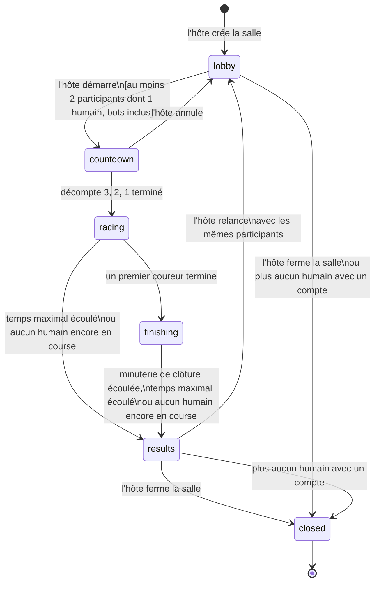
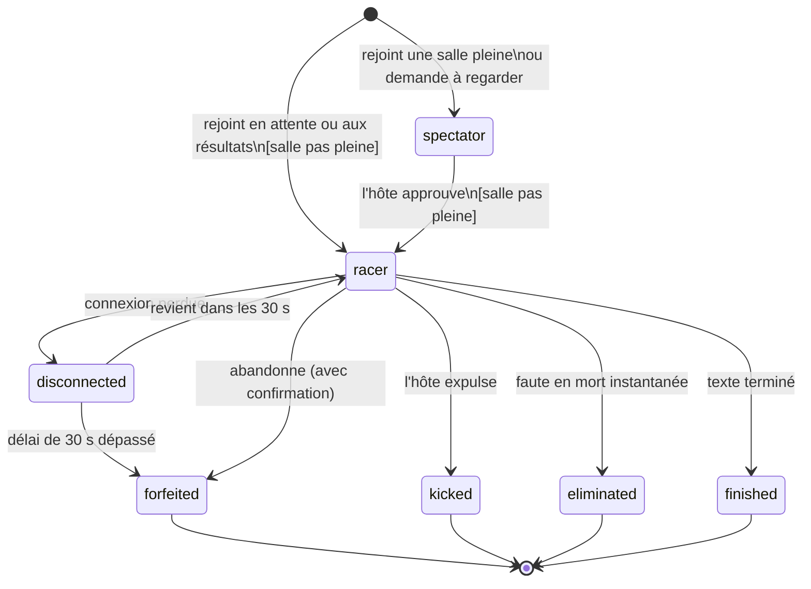

# Machine à états d'une salle et d'une course

Une salle passe par un nombre fixe d'états (COURSE-01). Le serveur temps réel est la seule autorité (COURSE-06) : un client ne change jamais l'état, il envoie une demande que le serveur accepte ou refuse selon l'état courant.

## États d'une salle

Les états du cahier des charges correspondent aux états du code ainsi :

| Cahier des charges | Code |
|---|---|
| EN_ATTENTE | `lobby` |
| DÉCOMPTE | `countdown` |
| EN_COURSE | `racing`, puis `finishing` dès qu'un premier coureur a terminé |
| RÉSULTATS | `results` |
| FERMÉE | `closed` |

`finishing` est un sous-état de EN_COURSE : la course continue exactement de la même façon, mais une minuterie de clôture est lancée (voir plus bas).

| État | Ce qui se passe | Qui peut agir |
|---|---|---|
| `lobby` | Les personnes arrivent. L'hôte règle la configuration, visible de tous en temps réel (CONF-12), ajoute des bots, expulse, approuve des spectateurs. | Hôte, participants (rejoindre, quitter, regarder) |
| `countdown` | Décompte synchronisé de 3 secondes (COURSE-03). Le texte est révélé au début du décompte pour que chacun puisse le lire, mais personne ne peut encore taper. | Hôte (annuler) |
| `racing` | Les coureurs tapent. Les positions sont diffusées environ 10 fois par seconde. Les bonus s'appliquent aux points de passage 25, 50 et 75 %. | Coureurs (frappe, abandon), hôte (expulsion) |
| `finishing` | Comme `racing`, avec la minuterie de clôture qui court. | Mêmes actions que `racing` |
| `results` | Classement, statistiques, carte de chaleur, records. Les résultats sont enregistrés dans `race_result`. On peut rejoindre la salle (SALLE-09). | Hôte (modifier la configuration, relancer vers `lobby` avec les mêmes participants, fermer) |
| `closed` | La salle n'accepte plus personne. Les liens d'invitation deviennent invalides. | Aucune |

## Fin de la course (COURSE-09)

COURSE-09 prévoit deux conditions de fin : tous les participants ont terminé ou abandonné, ou le temps maximal est écoulé. Nous en avons ajouté une troisième, et nous avons adapté la première. Ce sont deux choix délibérés.

La première condition vraie l'emporte :

1. **Aucun humain n'est encore en course** (tous ont terminé, abandonné, été éliminés, expulsés ou ont dépassé le délai de reconnexion) : fin immédiate.
2. **Le temps maximal choisi par l'hôte est écoulé** : fin immédiate.
3. **La minuterie de clôture est écoulée** : 30 secondes après l'arrivée du premier coureur (`CLOSING_MS` dans `app/server/race.ts`), même traitement que le temps maximal.

Les coureurs encore en course à la fin sont classés `timed_out`, selon leur progression (COURSE-10).

### Pourquoi une minuterie de clôture

L'hôte peut choisir « Aucune » limite de temps (CONF-07). Sans minuterie de clôture, une course sans limite resterait ouverte aussi longtemps qu'un seul joueur n'a pas fini. Un élève qui laisse son onglet ouvert sans taper, ou qui tape très lentement, bloquerait alors toute la salle : personne ne voit les résultats et l'hôte ne peut pas relancer. L'abandon (COURSE-07) ne règle pas le problème, puisqu'il dépend du joueur lent lui-même.

Avec la minuterie, la course se termine au plus tard 30 secondes après le premier arrivé. Ces 30 secondes laissent aux joueurs proches de la fin le temps de terminer, et la course ne dépasse jamais le temps maximal quand il y en a un (`closesAt = min(arrivée + 30 s, fin prévue)`). Le temps restant est affiché à tous les coureurs.

### Pourquoi les bots ne retiennent pas la course

Les bots comptent comme participants (COURSE-02), mais la course se termine dès qu'aucun humain n'est encore en course. Un bot de niveau « débutant » peut prendre plusieurs minutes à finir un long texte. Faire attendre les humains qui ont déjà fini n'apporte rien : les bots non terminés sont classés selon leur progression, comme n'importe quel coureur qui n'a pas fini à temps.

## États d'une personne dans une salle

- **Reconnexion (COURSE-08)** : un joueur qui recharge la page ou perd sa connexion reprend là où il était s'il revient dans les 30 secondes. Passé ce délai, il est retiré de la salle et classé comme ayant abandonné.
- **Abandon (COURSE-07)** : le bouton demande une confirmation. Un abandon est classé après ceux qui n'ont pas fini à temps (COURSE-10).
- **Mort instantanée** : la première faute classe le joueur `eliminated`, humain ou bot. Il est classé avec les abandons, selon sa progression.
- **Pas d'arrivée en cours de course (SALLE-09)** : on ne peut rejoindre que pendant l'attente ou les résultats. Pendant le décompte ou la course, la demande est refusée (`race_in_progress`), même pour devenir spectateur. Un membre déjà présent qui se reconnecte n'est pas concerné.
- **Salle pleine (SALLE-05)** : la capacité compte les participants humains et les bots, pas les spectateurs. Une personne qui rejoint une salle pleine entre comme spectateur.

## Départ de l'hôte (SALLE-08)

L'hôte peut nommer un autre hôte à tout moment. S'il quitte sans l'avoir fait, le rôle passe à la personne humaine **connectée** présente depuis le plus longtemps, participant ou spectateur. Si personne n'est connecté, on prend la plus ancienne personne encore dans son délai de reconnexion. S'il ne reste personne, la salle est fermée.

Seul un humain avec un compte peut être hôte, car la salle référence un utilisateur en base de données (`room.host_id`). Une salle où il ne reste que des invités est donc fermée.

## Une seule salle à la fois (SALLE-06)

- Un index unique partiel en base (`room_member_one_room_idx` sur `user_id` quand `left_at` est nul) empêche un compte d'être membre de deux salles.
- Si la personne essaie de créer ou de rejoindre une autre salle, le serveur répond `in_other_room` avec le code de la salle actuelle. L'interface propose alors de la quitter.
- Un deuxième onglet sur la même salle est rattaché au même membre (une connexion de plus), sans doublon.

## Visibilité d'une salle

| Visibilité | Comment on entre |
|---|---|
| `public` | Par code, par l'explorateur de salles (JOIN-02) ou par « Faire une course » (JOIN-03), qui choisit la salle publique joignable et non pleine la plus proche de sa capacité, la plus ancienne en cas d'égalité. |
| `semi_public` | Par code ou par lien (valeur par défaut). |
| `private` | Seulement avec un lien d'invitation à usage unique. Le lien est lié à l'adresse IP de la première personne qui l'utilise, révoqué si elle est expulsée et invalide à la fermeture de la salle. Un membre déjà présent peut se reconnecter sans nouveau lien. |

Le code est protégé contre la force brute (SALLE-10) : 10 tentatives ratées par IP et par minute, puis `too_many_attempts`.

## Messages entre client et serveur

Chaque message reçu est validé par un schéma Zod (`app/src/lib/schemas.ts`). Un message mal formé reçoit `bad_request`; un message valide reçu dans un état qui ne l'accepte pas est refusé avec une erreur.

| Direction | Message | Valide dans l'état |
|---|---|---|
| client vers serveur | `room:create` | toujours |
| client vers serveur | `room:join` (code, invitation) | `lobby`, `results` |
| client vers serveur | `room:quickplay` | toujours (accueil) |
| client vers serveur | `explorer:watch`, `explorer:unwatch` | toujours |
| client vers serveur | `room:visibility`, `room:invite`, `room:invites` | tous les états, hôte seulement |
| client vers serveur | `room:configure` (paramètres partiels, validés et fusionnés) | `lobby`, `results`, hôte seulement |
| client vers serveur | `member:watch` | `lobby` |
| client vers serveur | `member:approve`, `member:kick`, `member:promote` | hôte seulement |
| client vers serveur | `member:team` | `lobby`, hôte seulement |
| client vers serveur | `race:start` | `lobby`, hôte seulement |
| client vers serveur | `race:cancel` | `countdown`, hôte seulement |
| client vers serveur | `race:again` | `results`, hôte seulement |
| client vers serveur | `race:progress` (au plus 10 par seconde) | `racing`, `finishing` |
| client vers serveur | `race:forfeit` | `racing`, `finishing` |
| serveur vers clients | `room:state` (instantané complet) | à chaque changement |
| serveur vers clients | `race:positions` | environ 10 fois par seconde pendant la course |
| serveur vers explorateur | `rooms:list` | quand une salle publique change |
| serveur vers un client | `room:kicked`, `room:moved`, `room:closed` | expulsion, départ vers une autre salle, fermeture |

## Bots

- Le minimum de 2 participants inclut les bots (COURSE-02). Il faut toujours au moins un humain parmi les coureurs.
- L'hôte ajoute les bots un par un, chacun avec son niveau parmi cinq. Si les bots de remplissage sont activés, il s'en ajoute assez pour atteindre le minimum et équilibrer les équipes.
- Les bots sont pilotés par un générateur pseudo-aléatoire avec une graine : la même graine rejoue la même course.

## Équipes

- Quand l'hôte active les équipes, les participants sont répartis en deux équipes dans l'ordre d'arrivée. Une personne qui arrive ensuite rejoint la plus petite. L'hôte peut déplacer n'importe qui.
- Si les bots de remplissage sont activés, des bots s'ajoutent à la plus petite équipe jusqu'à l'égalité. Sinon, chaque équipe doit avoir au moins un coureur (erreur `empty_team`), mais des tailles différentes sont permises.
- L'équipe gagnante est celle dont la vitesse moyenne (MPM net) est la plus haute, pour ne pas désavantager une équipe plus petite.
