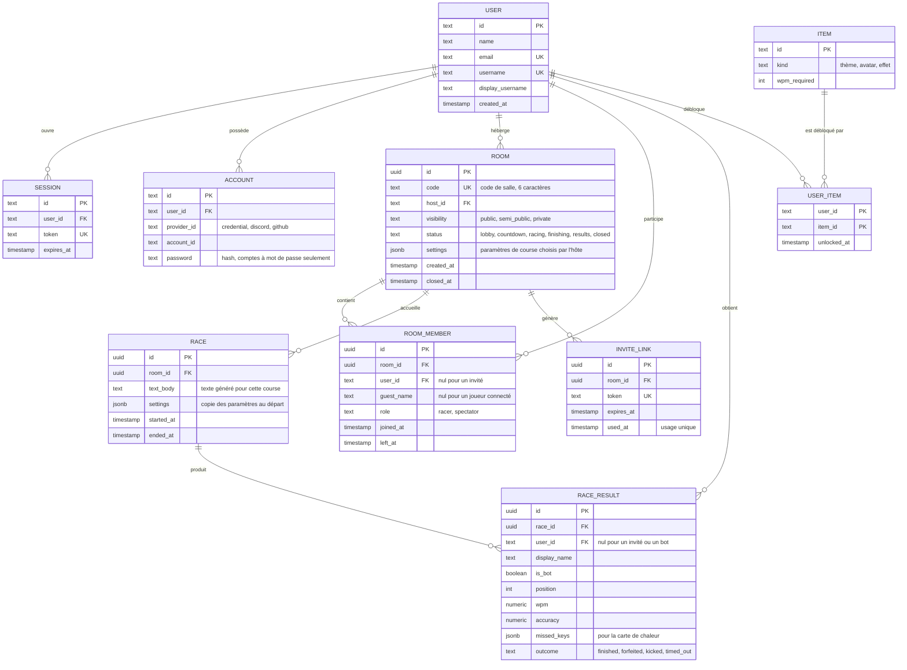

# Modèle de données

Base de données : PostgreSQL, accédée avec Drizzle ORM (`app/src/db/schema.ts`).

Les tables sont séparées en deux groupes :

- **Existantes** : générées pour Better Auth (comptes, sessions). Elles sont déjà dans le schéma.
- **Prévues** : nécessaires au point de contrôle 1 (salles) puis aux priorités suivantes. Elles ne sont pas encore créées.

## Principe : ce qui est persisté et ce qui reste en mémoire

L'état d'une course en cours (position de chaque coureur, progression de la frappe, minuteries) change plusieurs fois par seconde. Il vit **en mémoire dans le serveur temps réel** (voir [ADR 0001](adr/0001-temps-reel.md)) et n'est pas écrit dans PostgreSQL à chaque frappe.

PostgreSQL conserve ce qui doit survivre à un redémarrage : comptes, salles, résultats de course, statistiques et objets débloqués. Le résultat d'une course est écrit une seule fois, quand elle se termine.

## Diagramme

## Tables existantes

| Table | Rôle | Remarques |
|---|---|---|
| `user` | Compte utilisateur | `username` et `display_username` viennent du plugin *username* de Better Auth. |
| `session` | Sessions ouvertes | Jeton unique, expiration, supprimées avec l'utilisateur. |
| `account` | Méthodes d'authentification d'un utilisateur | Une ligne par méthode : `credential`, `discord`, `github`. C'est ce qui permettra d'ajouter une seconde méthode (exigence 1.6) sans changer le schéma. |
| `verification` | Jetons de vérification | Prévue pour la récupération de mot de passe (exigence 1.7). |

Comme Better Auth exige un courriel, les comptes créés avec nom d'utilisateur et mot de passe reçoivent une adresse interne de la forme `nom@users.invalid`. Elle n'est jamais utilisée pour envoyer un message.

## Tables prévues

| Table | Rôle | Exigences | Priorité |
|---|---|---|---|
| `room` | Une salle : code, hôte, visibilité, état, paramètres | 2.1, 2.7, 5.1 à 5.4 | 2 et 3 |
| `room_member` | Qui est dans la salle et avec quel rôle (coureur ou spectateur). `user_id` est nul pour un invité. | 1.4, 2.3, 2.4, 2.13 | 2 et 3 |
| `invite_link` | Lien d'invitation à usage unique pour une course privée | 5.3 | 3 |
| `race` | Une course jouée dans une salle (le texte et les paramètres au départ) | 3.10, 6.6 | 2 |
| `race_result` | Le résultat d'un joueur ou d'un bot pour une course | 1.5, 6.3 à 6.5 | 6 |
| `item`, `user_item` | Objets déblocables et ceux que chaque joueur possède | 6.7 | 6 |

Pour le point de contrôle 1, seules `room` et `room_member` sont nécessaires (créer une salle et la rejoindre par code).

## Choix de conception

- **Une salle peut accueillir plusieurs courses.** À la fin d'une course, l'hôte relance avec les mêmes participants (exigence 6.6). `room` et `race` sont donc deux tables distinctes.
- **Les invités n'ont pas de ligne dans `user`.** Ils sont identifiés par un `guest_name` et par leur connexion. Leur progression n'est pas conservée après leur départ (hypothèse 2).
- **Les bots ne sont pas des utilisateurs.** Ils n'apparaissent que dans `race_result` (`is_bot = true`) et ne comptent pas dans les statistiques d'un joueur (hypothèse 1).
- **Les paramètres sont stockés en JSON** (`settings`). Les options de l'hôte (exigences 3.x) sont nombreuses et vont évoluer; un champ JSON validé par le code évite une migration à chaque nouvelle option. La copie dans `race.settings` garde la trace de ce qui a réellement été joué.
- **Le code de salle** est unique, court et sans caractères ambigus (pas de `0`/`O`, `1`/`I`).
